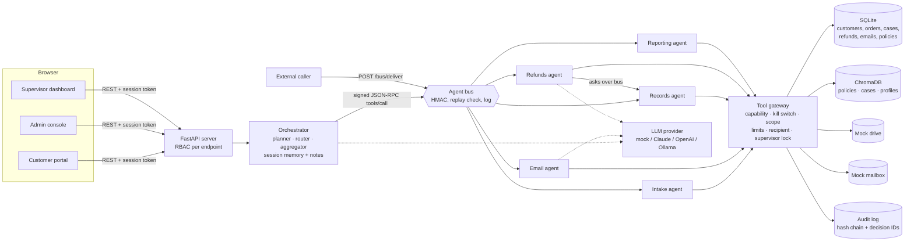

# Architecture

## Overview

## Components

| Component | File | Role |
|---|---|---|
| Orchestrator | `app/orchestrator.py` | LLM task decomposition (`plan`), LLM agent routing (`route`), LLM response aggregation (`aggregate`), short-term session memory and persistent notes. Runs the fixed refund workflow for each case. |
| Intake agent | `app/agents/intake.py` | Ticket submission (`submit_case`) and assignment (`assign_case`). |
| Email agent | `app/agents/email_agent.py` | Draft (LLM), send, receive and parse (LLM triage), filter and organise mail. |
| Records agent | `app/agents/records.py` | Case and profile access, storage (drive + vector DB), RAG retrieval over cases, profiles and policies, drive search. |
| Refunds agent | `app/agents/refunds.py` | Report review (`evaluate_case`: records over the bus, policy RAG, LLM recommendation, policy engine), approval (`decide_refund`), payment (`issue_refund`), escalation. |
| Reporting agent | `app/agents/reporting.py` | Approved / denied / escalated lists with reasons, weekly totals, weekly report file. |
| Tool gateway | `app/gateway.py` | The independent execution-boundary control. |
| Agent bus | `app/bus.py` | MCP-shaped JSON-RPC (`tools/call`, `tools/list`) with HMAC signatures. |
| Policy engine | `app/policy.py` | Parses uploaded policies (clamped to org hard limits) and evaluates cases deterministically. |
| Guardrails | `app/guardrails.py` | Injection detection, untrusted-input fencing, redaction, output sanitising. |
| Audit log | `app/audit.py` | Append-only, SHA-256 hash chain, decision ID per action. |

## Refund workflow (per case)

1. Intake: `submit_case` (contact email comes from the customer record, not the request), input filter flags suspected injection.
2. Intake: `assign_case` (flagged cases go to the supervisor queue).
3. Records: `store_case_file` (drive + vector DB).
4. Email: `draft_email` (LLM) then `send_email` acknowledgement.
5. Refunds: `evaluate_case`: fetches case, profile and policy over the bus, gets an LLM recommendation, runs the policy engine.
6. Refunds: `decide_refund` approve/deny, or `escalate_case`. A blocked decision fails safe to escalation, or to `on_hold` if authority is revoked.
7. Refunds: `issue_refund` credits the customer balance ("issue" = update the account balance).
8. Email: decision notification.
9. Reporting: `record_decision`.

The step order is fixed in code. The LLM can recommend but cannot reorder or
add consequential steps. Free-form chat requests are planned by the LLM, but
every planned step still goes through role checks, the bus and the gateway.

## Decision authority

The LLM proposes, the policy engine and gateway dispose:

- With guardrails on, the final decision is the policy engine's. If the LLM
  disagrees on an approvable case, the case is escalated to a human.
- The gateway re-checks every approval and payment (single and weekly limits,
  order ownership, amount, one refund per order, agreement with the policy
  engine) right before execution.
- Supervisor actions run with `human_authorized`, which skips the autonomous
  limits but not order checks, and lock the case against further agent action.

## Control inventory

| Control (`GUARDRAIL_DISABLE` name) | Where | Mitigates |
|---|---|---|
| RBAC per endpoint | `main.py` `require()` | ASI03 privilege abuse |
| `capability`: per-agent tool allow-list; unknown tools rejected; role allow-list for chat intents | gateway, orchestrator | LLM06 excessive agency, ASI02 tool misuse, ASI03 |
| `kill_switch`: no refund/email/profile-update after revocation | gateway | ASI10 rogue agents |
| `case_scope`: run bound to one customer; RAG filtered by customer | gateway, records | LLM02 disclosure, LLM08 vector weaknesses |
| `email_recipient`: mail only to the case contact | gateway | LLM05 output handling, ASI02 |
| `single_limit`, `weekly_limit` | gateway | LLM06, ASI08 cascading |
| `order_checks`: order ownership, amount, one refund per order | gateway | ASI02 |
| `policy_engine`: deterministic decision, LLM is advisory | refunds, gateway | LLM01, ASI01 goal hijack |
| `supervisor_lock`: supervisor decisions are final | gateway, orchestrator | ASI09 human-agent trust |
| `input_filter`: injection detection, fencing, length caps; flagged cases go to a human | guardrails, intake, email | LLM01, ASI01, ASI06 |
| `output_filter`: strip markup, mask account numbers, drop unknown addresses | guardrails, email, records | LLM02, LLM05 |
| `rate_limit`: max tool calls per run, max plan steps | gateway, orchestrator | LLM10 unbounded consumption |
| `bus_signature`: HMAC + replay check on inter-agent messages | bus | ASI07 insecure inter-agent comms |
| Policy upload clamp: uploads cannot raise limits or disable proof-of-purchase | policy | LLM04 poisoning, ASI06 |
| Hash-chained audit log with decision IDs | audit | MAESTRO L5 log tampering, accountability |
| UI renders all data as text (no innerHTML) | static/app.js | LLM05 |

## Known gaps worth testing (starting points for the Red team)

- The injection detector is a regex list: paraphrased or encoded injections get past it (the policy engine still holds).
- A policy upload can widen the purchase window up to 365 days.
- Persistent memory notes and stored case descriptions feed later prompts (memory/context poisoning path).
- `/bus/deliver` is unauthenticated apart from the HMAC; the shared secret is in `.env`.
- Session tokens never expire; passwords are demo passwords.
- The mock drive and mailbox are local files and tables, not real cloud APIs.
