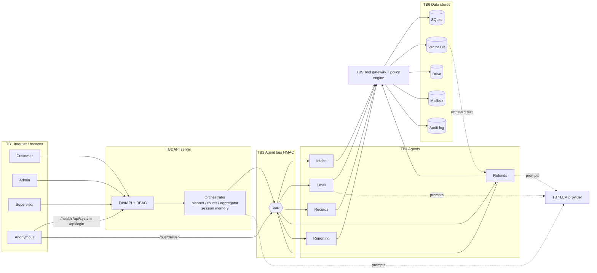

# Threat Model Outline: Refund Me Maybe

Sources: the code in `app/`, [docs/ARCHITECTURE.md](../docs/ARCHITECTURE.md), the
User Guide, the *Red Team Attacks* worksheet and the *Blue Team Defenses*
document. Test IDs (e.g. `RT 2.4`) refer to [../redteam/plan.md](../redteam/plan.md);
defence IDs (e.g. `BT 2.4`) refer to the Blue Team document. The per-layer
MAESTRO write-up goes in [MAESTRO_mapping.md](MAESTRO_mapping.md); section 8
below is its outline.

**Finding status:** `Confirmed` = reproduced (red-team run or in-process check) ·
`Code review` = seen in the code, not yet run · `Design` = accepted trade-off.
`Mitigated` = blue-team defence built and tested (see
[../blueteam/blue_team.md](../blueteam/blue_team.md)); the earlier finding is kept in brackets.

---

## 1. Scope

- **System:** browser-based, multi-agent refund support app (FastAPI, SQLite,
  ChromaDB or JSON fallback, mock drive and mailbox, pluggable LLM).
- **In scope:** REST API and UI, chat orchestration (planner, router, aggregator),
  the five agents, tool gateway, agent bus, policy upload and engine, RAG stores,
  memory, audit log, kill switch, deployment settings (workers, `.env`).
- **Out of scope:** the host OS, the LLM provider's own infrastructure, real payment
  rails and real email (both are mocks here).
- **Assumptions:** one sandbox deployment; all data synthetic; demo passwords;
  default single process unless stated; `BUS_SECRET` is random per process unless
  set in `.env`.

## 2. Assets

| ID | Asset | Why it matters | Where it lives |
|---|---|---|---|
| A1 | Customer balances (refund money) | Direct financial loss | `customers.balance`, `refunds` |
| A2 | Autonomous refund budget ($100 single / $500 weekly) | Org hard limits from the spec | `config.HARD_*`, active policy, `refunds` |
| A3 | Customer PII: name, email, phone, address, bank account and routing | Disclosure, fraud | `customers` (full); masked copies in vector DB, drive |
| A4 | Refund policy integrity | Decides what the agent may approve | `policies`, policy RAG chunks |
| A5 | Supervisor decisions (finality) | Human oversight | `cases.supervisor_locked` |
| A6 | Kill switch availability and effect | Emergency stop | `system_state.agent_authority`, supervisor login |
| A7 | Audit log integrity | Accountability, evidence for the Board | `audit_log` hash chain, `logs/events.jsonl` |
| A8 | Credentials and secrets | Session tokens, `BUS_SECRET`, LLM API keys | `sessions` (hashed), `.env` |
| A9 | Outbound email channel | Phishing or spam in the company's name | `emails`, Email agent |
| A10 | Availability and LLM budget | Cost, supervisor queue capacity | LLM provider, review queue |
| A11 | System prompts and configuration | Recon for further attacks | prompts in code, `/api/system` |

## 3. Threat actors

| ID | Actor | Access | Motivation |
|---|---|---|---|
| T1 | Malicious customer | Own account: case form, chat, support email | Extra or unearned refunds, other customers' data |
| T2 | Anonymous network attacker | Unauthenticated endpoints, login form, `/bus/deliver` | Recon, DoS, lockout |
| T3 | Malicious or compromised admin | Policy upload/activate, reports, all cases, sandbox reset | Loosen policy, read PII, erase evidence |
| T4 | Compromised supervisor credentials | Approve any refund, kill switch | Bypass all autonomous limits |
| T5 | Holder of a leaked `BUS_SECRET` | Signs bus messages as any sender | Act as an internal agent |
| T6 | Insider with host or file access | SQLite file, `.env`, drive, logs | Tamper with the audit log, steal secrets |
| T7 | Hijacked or unreliable LLM | Plans, routes, recommendations, email drafts | Indirect effect of T1 injection, or hallucination |
| T8 | Supply chain | Python packages, model weights, PDF/DOCX parsers | Code execution, poisoned behaviour |

## 4. Architecture and trust boundaries

| Boundary | Crossing | Trusted side enforces |
|---|---|---|
| TB1 -> TB2 | HTTP requests | Session token, `require()` RBAC, Pydantic types |
| TB2 -> TB7 | Prompts out, JSON in | Fencing (`wrap_untrusted`), JSON parse, fallback defaults |
| TB2 -> TB3 | Bus messages | HMAC per sender, freshness, replay, route allow-list |
| Network -> TB3 | `/bus/deliver` | HMAC only; external context gets `scope_customer=""` |
| TB4 -> TB5 | Tool calls | Capability, kill switch, scope, limits, recipient, supervisor lock |
| TB6 -> TB7 | RAG text into prompts | Customer filter on cases/profiles; policy chunks unfenced |
| Earlier -> later turn | Session memory | History is **not** fenced (only the current message is) |
| Admin -> policy | Upload | Clamp of limits only; no approval step |

## 5. Entry points

| # | Entry point | Auth today | Reaches |
|---|---|---|---|
| E1 | `POST /api/cases` | Customer | Intake -> full refund workflow, 3+ LLM calls |
| E2 | `POST /api/chat` | Any role | Planner, router, aggregator LLMs -> any role-allowed intent |
| E3 | `POST /api/inbox/send` | Customer | Email triage LLM, mailbox |
| E4 | `POST /api/policies`, `/activate` | Admin | Parser, policy engine rules, policy RAG |
| E5 | `POST /bus/deliver` | HMAC signature only | Any agent tool in an external, unscoped context |
| E6 | `GET /health`, `GET /api/system` | **None** | Config, guardrail state, policy rules, tool inventory, kill-switch state |
| E7 | `/tasks`, `/logs`, `/tests/rt-01` | Admin / supervisor | Orchestrator, event log |
| E8 | `POST /api/login` | None | Session creation, lockout counter |
| E9 | Supervisor endpoints (decision, rerun, authority) | Supervisor | Human-authorised refunds, kill switch |
| E10 | `POST /api/admin/reset-sandbox` | Admin | Drops and re-creates **all** tables |

## 6. Existing controls (summary)

The full table is in [docs/ARCHITECTURE.md](../docs/ARCHITECTURE.md#control-inventory).
In short: RBAC per endpoint · gateway `capability`, `kill_switch`, `case_scope`,
`email_recipient`, `single_limit`, `weekly_limit`, `order_checks`,
`policy_engine`, `supervisor_lock`, `rate_limit` · `input_filter` / `output_filter`
guardrails · bus HMAC, freshness, replay and route checks · policy-upload clamp ·
hash-chained audit log · `textContent`-only UI · session TTL and login lockout.

## 7. Threat register

Likelihood (L) and Impact (I) are High / Medium / Low for the sandbox as
deployed. Each row gives the strongest current control, the remaining gap,
and the tests and defences that cover it.

### 7.1 Spoofing and elevation of privilege

| ID | Threat | Actor / entry | L / I | Current controls | Gap | Status | RT / BT |
|---|---|---|---|---|---|---|---|
| S1 | Customer plans intents beyond their role (process_case, export, permission change) | T1 / E2 | M / H | `ROLE_INTENTS` allow-list, gateway capability | Unknown intents are tried as raw tool names when `capability` is off | Code review | 1.4, 1.7 / BT 1.4, 1.7 |
| S2 | Forged or replayed bus message | T2 / E5 | L / H | HMAC, 60 s window, replay cache, routes | Replay cache is per process (config E) | Code review | 3.1a-b / BT 3.1 |
| S3 | **Leaked `BUS_SECRET` reads all customers' mail and refunds** | T5 / E5 | L / H | External context has `scope_customer=""` | `list_emails` (`email_agent.py:349`) and `refund_report` (`reporting.py:231`) filter only when scope is truthy, so `""` means "everything"; `organize_email`/`receive_email` have no scope check (spoofed inbound mail). One master key derives all sender keys | **Mitigated** (BT 3.1d, case_scope) [was: **Confirmed** (in-process, valid key)] | 3.1d / BT 3.1 |
| S4 | Lockout of the only supervisor blocks the kill switch and decisions | T2 / E8 | H / H | 5 failures / 15 min lockout | Per-username only, no per-source limit, one supervisor account, no break-glass path | Code review (by design) | 8.2 / BT 8.2 |
| S5 | Compromised supervisor approves anything | T4 / E9 | L / H | `order_checks` still apply; audit row | Human path skips single, weekly and policy-engine checks; note is optional; no second approver | Design | 7.6 / BT 7.6 |

### 7.2 Tampering (money, policy, data)

| ID | Threat | Actor / entry | L / I | Current controls | Gap | Status | RT / BT |
|---|---|---|---|---|---|---|---|
| T-1 | Prompt injection makes the agent approve or overpay | T1, T7 / E1 | H / H | Policy engine decides; gateway re-checks; injection flag escalates | Regex filter is easy to bypass (encoding, paraphrase); acceptable because the engine holds | Confirmed held in tests | 1.1, 1.2, 1.6 / BT 1.1, 1.2 |
| T-2 | Injection via `order_id` | T1 / E1 | M / M | Engine denies unknown orders | No format or length check (`intake.py:24`); unfenced in Refunds prompt (`refunds.py:124`), email prompt (`email_agent.py:265`) and vector DB `case_doc` (`records.py:57`) | **Mitigated** (BT 1.3, input_validation) [was: Code review] | 1.3 / BT 1.3 |
| T-3 | Weekly cap or one-refund-per-order race | T1 / E1 | M / H | `_CONSEQUENTIAL_LOCK` (`gateway.py:70`) | `threading.RLock` is per process; SQLite check and insert are not one transaction, so `--workers 4` can break the cap | Code review | 2.3, 2.4 / BT 2.3, 2.4 |
| T-4 | Salami refunds just under the limits | T1 / E1 | H / M | Weekly cap counts all customers | Within policy by design; calendar week resets Monday 00:00 UTC | Design | 2.2, 2.6 / BT 2.2, 2.6 |
| T-5 | Malformed amounts (NaN, Infinity, negative) | T1 / E1 | M / M | Engine denies ≤ 0 and > order total | NaN gives HTTP 500 (NOT NULL) instead of 422; Infinity is stored | **Mitigated** (BT 2.7, input_validation) [was: Code review (BT doc)] | 2.1, 2.7 / BT 2.1, 2.7 |
| T-6 | **Policy poisoning by admin: widen or disable autonomy** | T3 / E4 | M / H | Clamp of single/weekly ceilings; proof-of-purchase and one-per-order forced on | Policy goes live at once, no approver; old versions re-activatable; window up to 365 days; `-1` limit and empty `eligible_reasons` accepted with no warning (all cases escalate) | **Mitigated** (BT 4.2/4.5, policy_validation + two_person_policy) [was: **Confirmed** (in-process)] | 4.2, 4.5 / BT 4.2, 4.5 |
| T-7 | **`nan` policy limit disables the gateway single-limit check** | T3 / E4 | L / H | Policy engine still escalates | `nan > 100` is false so no clamp (`policy.py:85`); gateway `min(nan, 100)` is `nan` so `check_single_limit` never fires (`gateway.py:226`); upload returns 500 but the policy is **active**; `/api/system` then returns 500 | **Mitigated** (BT 4.6, policy_validation) [was: **Confirmed** (in-process)] | 4.6 / BT 4.6 |
| T-8 | Injected instructions in policy text reach the Refunds LLM | T3 / E4 | M / L | Engine is final | Policy chunks are not fenced; parser reads `key: value` lines anywhere if no `policy-rules` block | Code review | 4.3, 7.4 / BT 4.3 |
| T-9 | Memory poisoning across turns | T1 / E2 | M / L | Planner output still role-checked | Earlier turns go into the planner prompt unfenced (`orchestrator.py:88-89`); persistent `user:` notes are never written, and case outcome notes are never read (dead path) | Code review | 7.1, 7.5 / BT 7.5 |
| T-10 | Supervisor decision race (double submit) | T4 / E9 | L / L | `order_checks` blocks a second refund | Lock check then act (`main.py:307`) can send duplicate emails | Code review | — |

### 7.3 Repudiation and audit

| ID | Threat | Actor / entry | L / I | Current controls | Gap | Status | RT / BT |
|---|---|---|---|---|---|---|---|
| R1 | **Admin erases the audit trail with Reset sandbox** | T3 / E10 | M / H | Admin-only endpoint | `db.seed(reset=True)` drops every table, including `audit_log`; contradicts "cannot alter audit logs" | **Mitigated** (BT R1, audit_protect) [was: Code review] | 8.4 / BT 8.4 |
| R2 | Insider rewrites the hash chain | T6 | L / H | SHA-256 chain, `/api/audit/verify` | Chain is not anchored outside the DB; a file writer can recompute it; `events.jsonl` is not chained | Code review | 8.4 / BT 8.4 |
| R3 | Log injection forges entries | T1 / E1-E3 | L / M | JSON lines via `json.dumps` | Verify that newlines in fields cannot split rows | Code review | 8.4 / BT 8.4 |

### 7.4 Information disclosure

| ID | Threat | Actor / entry | L / I | Current controls | Gap | Status | RT / BT |
|---|---|---|---|---|---|---|---|
| I1 | Cross-customer case or profile via chat | T1 / E2 | H / H | `case_scope` | — | Confirmed held (Qwen) | 5.1 / BT 5.1 |
| I2 | Case-ID enumeration oracle | T1 / E2 | H / L | REST returns 404 for both | Chat says "belongs to another customer" vs "not found" (`gateway.py:192` vs `records.py:76`) | **Mitigated** (BT 5.2, case_scope) [was: **Confirmed** (Qwen + in-process)] | 5.2 / BT 5.2 |
| I3 | Unauthenticated recon | T2 / E6 | H / M | — | `/health` and `/api/system` return guardrail state, limits, tools, kill-switch state | **Mitigated** (BT 5.3, recon_auth) [was: **Confirmed** (Qwen)] | 5.3 / BT 5.3 |
| I4 | Admin reads all customer cases | T3 / REST | M / M | — | `GET /api/cases` and `/api/cases/{id}` return every case, description and contact email to admins (`main.py:162-181`) | Code review | 5.4 / BT 5.4 |
| I5 | Raw bank numbers in some channel | T1, T3 | L / H | Masked in vector DB, drive, profile view; `redact` on audit | Check `/api/llm-calls` raw output and `/api/bus` bodies; masking depends on `output_filter` for the profile view | Code review | 5.5 / BT 5.5 |
| I6 | System prompt leak | T1 / E2 | M / L | Prompts hold no secrets | — | Confirmed held (Qwen) | 5.6 / BT 5.6 |
| I7 | Email to an attacker address | T1, T7 / E1 | M / H | `email_recipient` gateway check; resend to contact | Model-supplied `to` is still stored on the draft (`email_agent.py:279`) | Code review | 6.1 / BT 6.1 |

### 7.5 Denial of service and cost

| ID | Threat | Actor / entry | L / I | Current controls | Gap | Status | RT / BT |
|---|---|---|---|---|---|---|---|
| D1 | Cost amplification and case spam | T1 / E1-E3 | H / M | 30 tool calls/run, 8 plan steps, 4,000-char cap (8,000 in chat) | No per-user rate limit or quota; each case makes several LLM calls; slow local models make it worse (Qwen run: ~4-9 min per attack) | Code review | 8.3, 6.6 / BT 8.3, 6.6 |
| D2 | Escalation flood on the supervisor queue | T1, T3 | M / M | Fail-closed to escalate | No queue limits or alerts; poisoned policy (T-6, T-7) escalates everything | Confirmed via T-6 / T-7 | 4.2, 8.6 / BT 8.6 |
| D3 | LLM outage | T7 | M / M | `complete_json` falls back to defaults -> escalate | Fail-closed works; volume becomes D2 | Confirmed (Qwen timeout -> escalate) | 8.6 / BT 8.6 |
| D4 | Malicious upload files | T3 / E4 | L / M | 2 MB cap | No parse time or page limit; type taken from file name | Code review | 4.4 / BT 4.4 |

### 7.6 Kill switch and oversight

| ID | Threat | Actor / entry | L / I | Current controls | Gap | Status | RT / BT |
|---|---|---|---|---|---|---|---|
| K1 | Action slips through after revocation | T7 | L / H | DB-backed state, checked on every consequential call, shared across workers | Non-consequential steps (evaluate, draft, store, escalate) and their LLM calls still run | Code review | 8.1, 8.5 / BT 8.1, 8.5 |
| K2 | Supervisor finality bypassed | T7 | L / H | `supervisor_lock` in gateway and orchestrator | — | Held in unit tests | — |
| K3 | Automation bias in review | T4 | M / M | Review page shows engine checks, LLM recommendation, raw description | No required reason on approval | Design | 7.6 / BT 7.6 |

## 8. MAESTRO layer outline

| Layer | Main threats | Register IDs |
|---|---|---|
| L1 Foundation model | Injection, jailbreak (ENI persona), hallucinated tool args, timeouts | T-1, T-2, I6, D3 |
| L2 Data operations | Policy RAG poisoning, keyword stuffing, memory poisoning, PII in stores | T-6, T-7, T-8, T-9, I5 |
| L3 Agent frameworks | Planner/router hijack, tool misuse, excessive agency | S1, T-1, I7 |
| L4 Deployment and infrastructure | Per-process locks and caches, unauthenticated recon, single bus master key | T-3, S2, S3, I3 |
| L5 Evaluation and observability | Audit wipe, chain not anchored, log injection | R1, R2, R3 |
| L6 Security and compliance | RBAC gaps (admin reads cases), policy change without approval | I4, T-6, S5 |
| L7 Agent ecosystem | Inter-agent trust, kill switch reach, supervisor lockout | S2, S3, S4, K1 |

## 9. Priorities

1. **Fix first:**
   - Validate policy rules strictly (finite numbers, positive values, non-empty reasons, bounded window) and require approval before activation (T-6, T-7).
   - Make `""` scope mean "no customer data" in every tool (S3).
   - Protect the audit log from Reset sandbox (R1).
   - Lock down `/api/system` and `/health` (I3).
2. **Next:**
   - Enforce the weekly cap in the database (`BEGIN IMMEDIATE`) (T-3).
   - Give the same answer for "not found" and "not yours" in chat (I2).
   - Validate the `order_id` format (T-2).
   - Reject NaN and Infinity at the API boundary (T-5).
   - Fence the chat history (T-9).
   - Add a second supervisor and a break-glass path, plus per-source lockout (S4).
3. **Later:**
   - Per-user rate limits and quotas (D1).
   - Anchor the audit chain outside the DB (R2).
   - Restrict admin access to cases (I4).
   - Ignore the model's `to` field (I7).
   - Sandbox the policy parser (D4).

## 10. Residual risks and open questions

- Prompt injection cannot be removed, only contained. The design relies on the
  policy engine and gateway, not the filter.
- A compromised supervisor can approve any refund. Two-person approval would
  reduce this but not remove it.
- Calendar week vs rolling 7-day window: record it as a governance decision.
- Should Reset sandbox exist in a "production" variant at all, or only in
  sandbox builds?
- Which roles may read case PII: supervisor only, or admin with masking?
- Live results so far cover only 6 tests on one model (Qwen, partial); the
  in-process checks above used the mock LLM.
